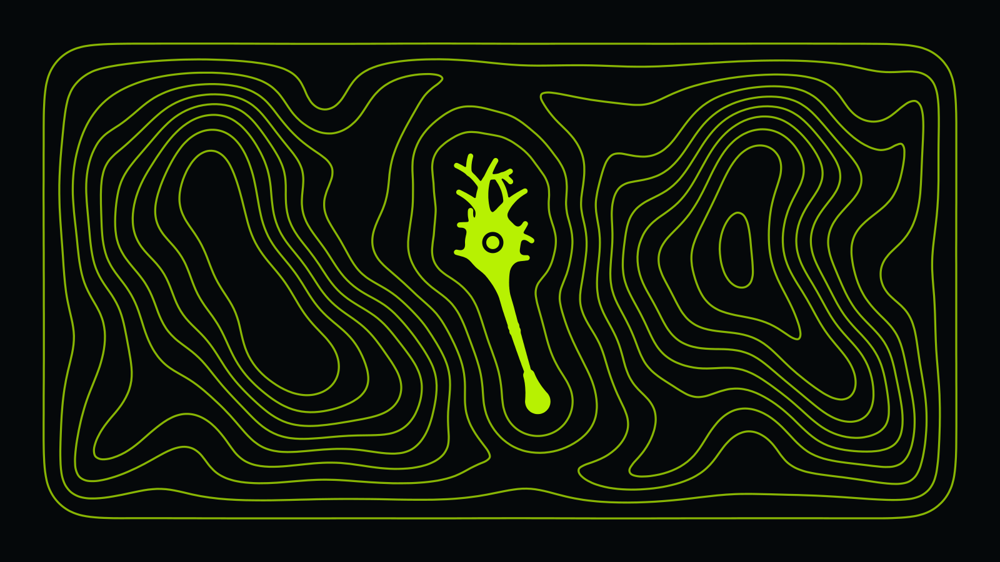

# Skills

## Install

```sh
claude plugin marketplace add HeBtcd/skills && claude plugin install skills@hebtcd
```

```sh
cp -r skills/is-this-a-thing ~/.claude/skills/ # or copy a folder: Claude Code
cp -r skills/is-this-a-thing ~/.agents/skills/ # agents-compatible harnesses
```

## The moments

| Skill | Description |
|---|---|
| [play-it-back](skills/play-it-back/SKILL.md) | Play back the user's goal and the problem behind it so they can confirm or correct it before you act. Use when a request is ambiguous, when the literal ask may not be the real goal, or when a message is short, vague, or corrective. |
| [what-are-we-assuming](skills/what-are-we-assuming/SKILL.md) | Audit the assumptions a request, judgment, or plan rests on. Use when a request may be a proposed solution rather than the problem itself, when premises may be unstated, or when a judgment is challenged. |
| [is-this-a-thing](skills/is-this-a-thing/SKILL.md) | Find the established name and original source of a concept, rule, or practice. Use when an idea may already exist under a standard name, including before writing a new Skill or building an unfamiliar capability from scratch, or when a quote, rule, or method needs tracing to whoever actually coined it. |
| [deep-research](skills/deep-research/SKILL.md) | Research a decision against field evidence: postmortems, incident reports, and real-world failure cases. Use when the question is what actually happens in production and standard recommendations or generic summaries fail to settle an important decision. Not for naming lookups or codebase questions. |
| [when-in-rome](skills/when-in-rome/SKILL.md) | Match the existing implementations and house style of an established codebase before writing new code in it. Use when adding a feature, function, test, or file, and the question is how this place does things rather than how you would. |
| [functional-programming](skills/functional-programming/SKILL.md) | Functional design: model the domain in types, keep state essential, parse at the boundary, push side effects to the edges, refactor by substitution, and write laws as properties. Use when modeling a domain, untangling state and branching, deciding where side effects live, or refactoring toward correctness. |
| [let-it-crash](skills/let-it-crash/SKILL.md) | Failure-path contracts and ownership: who owns each check, where recovery lives when the worker crashes, whether a breach could pass unnoticed. Use when deciding who validates what, auditing error handling, or checking whether a failure could go unseen. |
| [open-from-day-one](skills/open-from-day-one/SKILL.md) | Takeover-readiness for a repo or artifact: keep it able to go public or change hands at any moment, so a stranger on a clean machine can build, run, change, release, and take it over without asking you. Use when shaping a project, checking repo hygiene, or preparing work for outsiders or future maintainers. |
| [performance-engineering](skills/performance-engineering/SKILL.md) | Model a workload's cost, locate the bottleneck, bound the speedup, and prove the claim. Use when something is too slow or allocation-heavy, when a workload's cost must be estimated before building or changing it, or when a claimed speedup needs evidence. |
| [slim](skills/slim/SKILL.md) | Slim an artifact from the design down: cut the parts that never earned or never ran, undo a wrong decomposition, or grow a smaller replacement at the edges of the old. Use when something is bloated or over-built and the question is what can go, or when a failing repro needs shrinking to its minimum. Parts and structure, not prose. |
| [show-your-math](skills/show-your-math/SKILL.md) | Show the working behind a number or default: the relation it comes from, each input's bounds, the weakest link, the choice left over. Use when a constant needs defending, an estimate is challenged, or the user asks where a figure came from. |
| [write-the-docs](skills/write-the-docs/SKILL.md) | Write or edit project documentation: the README, the design doc, the module doc, the decision record, the changelog. Use when a project document needs writing or re-cutting: naming which kind it is, drafting it for the reader who needs it, or checking that it still tells the truth. |
| [for-the-audience](skills/for-the-audience/SKILL.md) | Turn threads, notes, and review back-and-forth into a self-contained document for the audience that was not in the room. Use when a pile of working materials must stand alone for readers who lack the backstory: will a stranger be able to read it? |
| [plain-language](skills/plain-language/SKILL.md) | Rewrite text in plain language while preserving its exact meaning. Use when a spec, instruction, doc, or UI copy is too long, jargon-dense, or overwrought for its reader. |
| [managing-up](skills/managing-up/SKILL.md) | Report finished work or escalate a decision to a delegator who did not follow the work. Use when reporting back, requesting a decision, or answering a review. |
| [review-the-pr](skills/review-the-pr/SKILL.md) | Review a pull request produced faster than anyone can read: machines verify what they can, context checks cover what the diff cannot carry, and a person signs the risk. Use when asked to review, approve, or sign off on a PR, or to sweep a codebase for every instance of a defect class. |
| [straight-answer](skills/straight-answer/SKILL.md) | Audit a reply before accepting or sending it. Use when a draft argues against the user's position, answers criticism, raises an objection or caveat, or reads defensive, padded, or mis-calibrated. |
| [prove-it-wrong](skills/prove-it-wrong/SKILL.md) | Falsify your own conclusion before accepting it. Use when supporting reasons have piled up, when a self-built diagnosis or fix 'should work', or when everything seems to confirm: what would make it break? |
| [hebtcd-skill-creator](skills/hebtcd-skill-creator/SKILL.md) | Compose a Skill as an ordered basis of Things behind a trigger pointer. Use when deciding whether a capability, a recurring move, or a named concept deserves a Skill of its own, or when an existing Skill's basis needs re-cutting. |

## License

[MIT](LICENSE)
